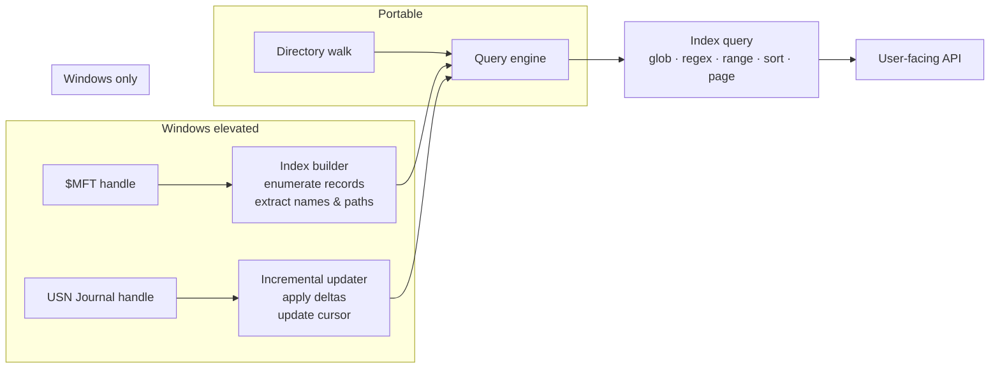

# OpenFinder


OpenFinder builds an index of your files by reading the NTFS Master File Table directly — no directory traversal, no shelling out to `dir`. For follow-up, it watches the USN Journal for incremental updates so rebuilding only takes seconds.

## 🔍 What it does

OpenFinder is a fast file search engine with two execution paths:

- **`$MFT` direct reader (Windows)** — opens the NTFS master file table as a raw handle, enumerates all file records, and builds a searchable index in a fraction of the time a recursive walk would take. Requires administrator elevation.
- **USN Journal incremental update (Windows)** — after the first build, subscribes to the USN Journal to catch creates, deletes, and renames without re-reading the whole volume. Falls back to a full rebuild only when the journal cursor has aged past its retention window.
- **Walk mode (portable)** — on non-Windows platforms, or when elevation is not available on Windows, OpenFinder degrades to a conventional directory walk with the same query API and output shape.

Every mode supports the same query surface: glob patterns, regex matching, size ranges, modification-time windows, file/dir kind filters, multi-key sorting, and pagination.

- **Content search (`search`)** — a separate entry point for conditions that require reading file bytes, such as line-count filters for code analysis. Metadata queries never open a file; a content search always does, so it carries its own cost contract: directory-level `--exclude` pruning (the `code` preset drops `node_modules`, `.git`, `dist`, and friends before traversal), streaming line counts with early rejection, and budgets (`--max-files`, `--max-bytes`, `--timeout-ms`) that stop early and report `budgetExceeded` instead of silently returning partial results.
- **Read-only diagnostics (`volumes`, `inspect`)** — enumerate logical volumes with filesystem, capacity, and index status, and inspect one path's metadata, recursive size, attributes, reparse target, and minimal git state (branch, HEAD, remotes). Both run in-tree: no `wmic`, no PowerShell, no third-party search tool, no `git` process, and no index write.

## 🚀 CLI in action

Build an index for your Windows C: volume (requires elevation):

```bash
open-finder index --volume C: --json
```

Scan the indexed volume with a glob, path filter, and size sort:

```bash
open-finder scan --pattern "*.dll" --path-filter "\\Windows\\System32" --sort size --desc --json
```

Use regex for installers on a non-indexed volume or a portable OS:

```bash
open-finder scan --mode walk --root ./downloads --regex --pattern "^(setup|installer).*\\.exe$" --limit 20
```

Find the biggest source files in a repository for a code review — line conditions belong to `search`, and `node_modules` never slows it down:

```bash
open-finder search --root ./repo --include "*.rs,*.ts" --min-lines 500 --sort lines --desc --limit 20 --json
```

Answer "which volumes are indexed" and "what is this path" without leaving the tool:

```bash
open-finder volumes --json
open-finder inspect --path <path> --json
```

## 🏗️ How it works



The `$MFT` path skips directory enumeration entirely — it reads the flat record table that NTFS maintains for every file on the volume. The trade-off is administrator elevation, which OpenFinder will explicitly request and will never silently skip. The walk path uses the same query engine so your scripts don't need to branch by OS.

## ⚠️ What it does NOT do

- It does **not** bypass NTFS permissions on files themselves. Indexing only reads the `$MFT` metadata; opening file contents still follows your process's access token.
- It does **not** work on FAT32, exFAT, or ReFS. Only NTFS volumes expose the `$MFT` and USN Journal interfaces.
- It does **not** provide real-time indexing without you asking. After the first build, run `index --update` periodically — the USN Journal does not push updates to a running daemon.
- It does **not** mount or decrypt BitLocker-encrypted volumes. The `$MFT` is only readable after the volume is unlocked by the OS.
- It does **not** deduplicate results. Hard-linked files appear as separate entries because OpenFinder indexes by record, not by inode content.

## 🖥️ Platform notes

| Capability | Windows | macOS / Linux |
|------------|---------|---------------|
| `$MFT` direct indexing | ✅ elevated | ❌ unsupported_platform |
| USN Journal incremental update | ✅ elevated | ❌ unsupported_platform |
| Index-based scan | ✅ | ✅ (after `index` on a supported platform) |
| Walk-mode scan | ✅ | ✅ |

When elevation is not available on Windows, OpenFinder falls back to walk mode and reports the capability gap in the response. It never silently returns empty results.
